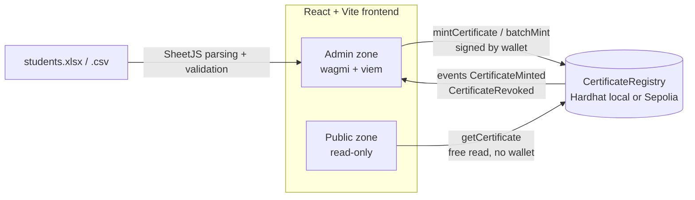
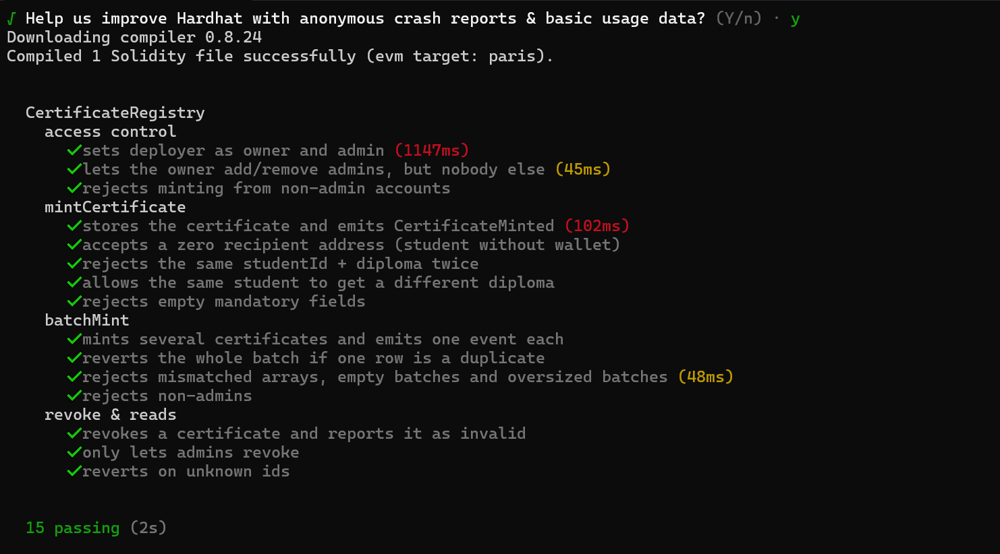
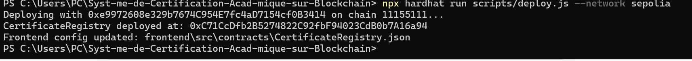
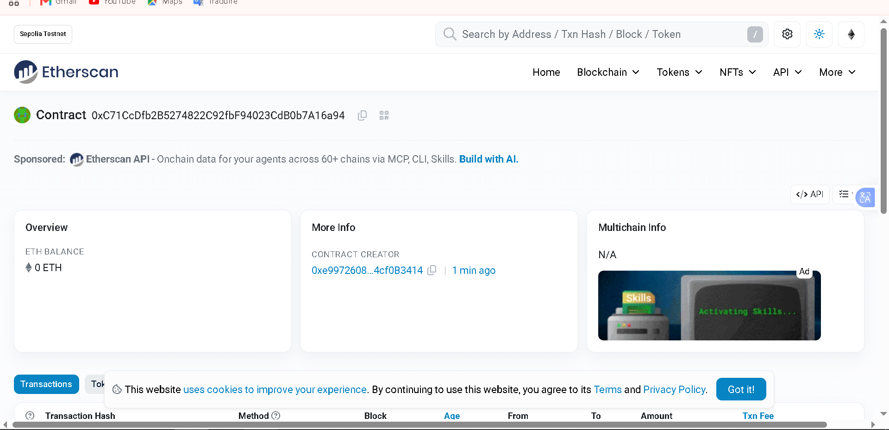
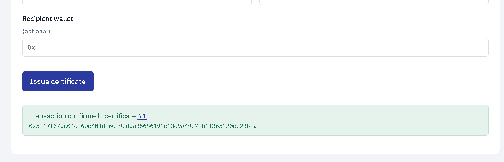
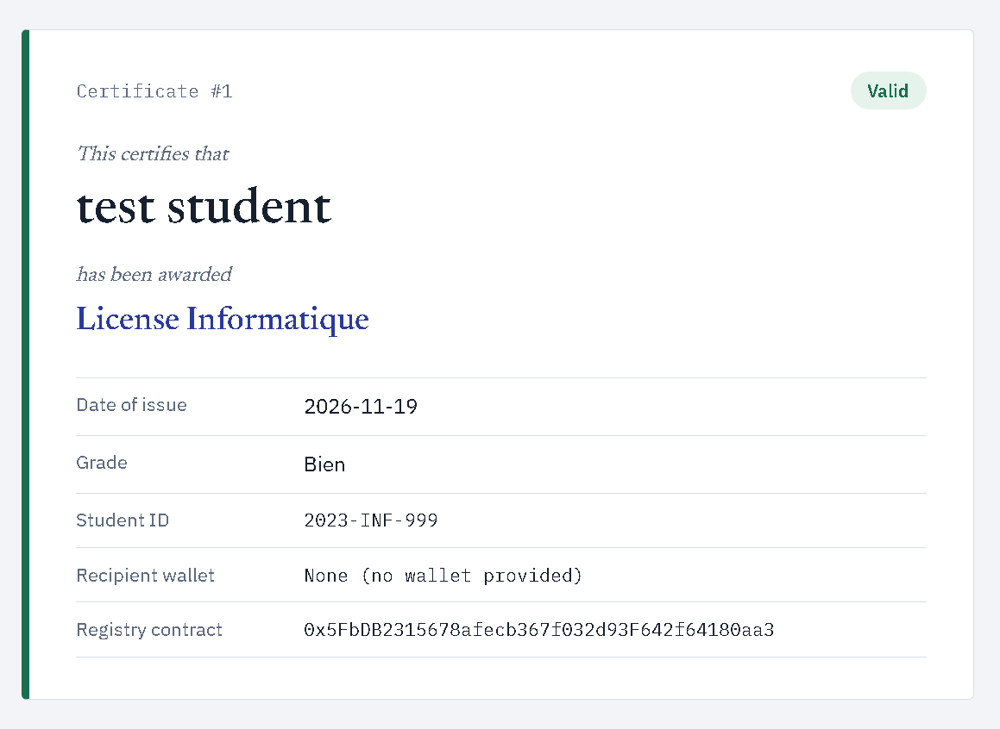
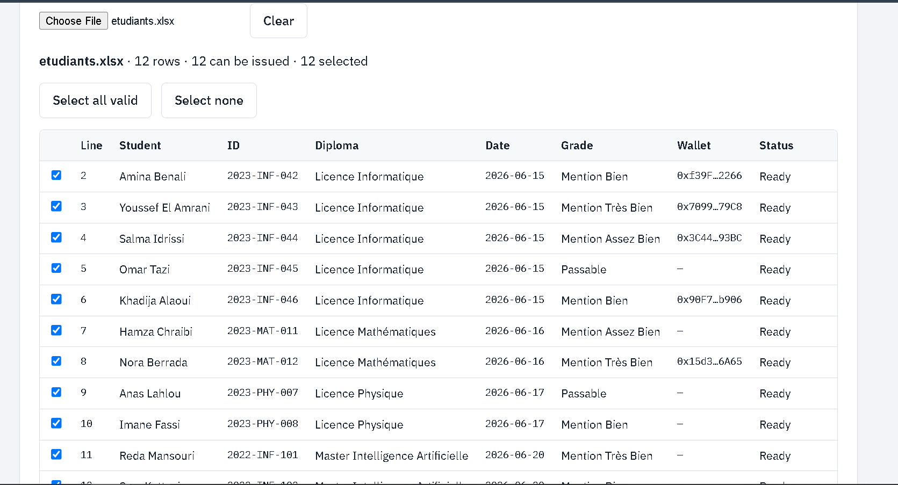
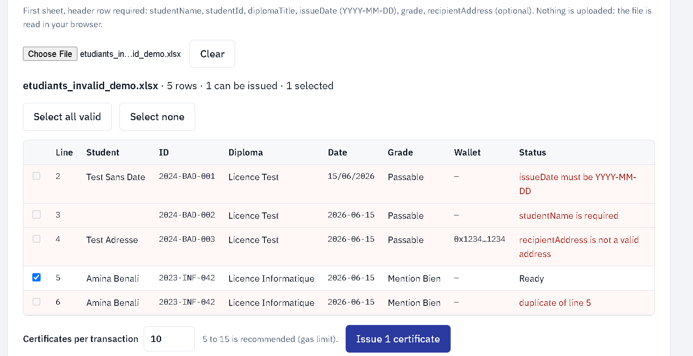
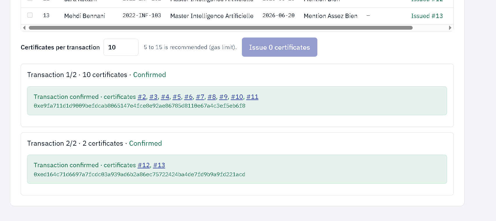
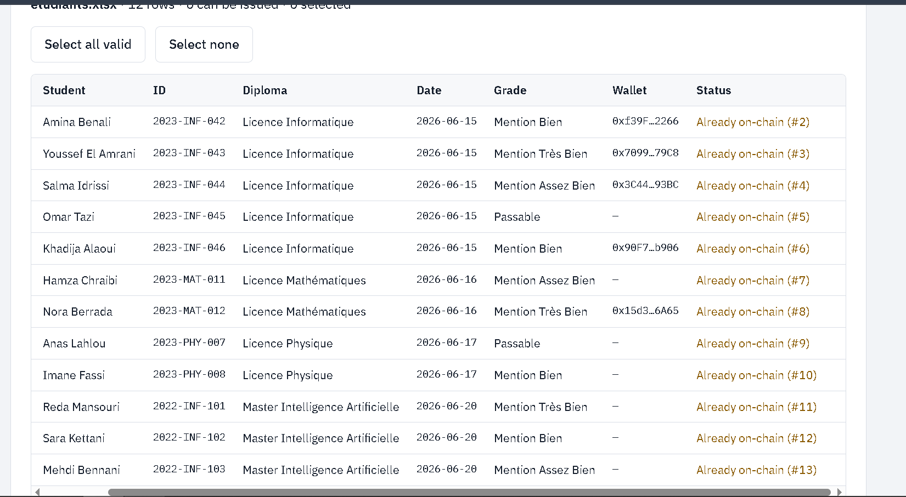

# Diploma Registry: Academic Certification on Blockchain

> Assignment 1: an end-to-end system (smart contract + web frontend + Excel import) to issue and publicly verify academic certificates, independently of any central database.

**Author:** _Your name_ · **Course:** _Course name_ · **Date:** _Date_

**Deployed contract (Sepolia):** `0xC71CcDfb2B5274822C92fbF94023CdB0b7A16a94` · [View on Etherscan](https://sepolia.etherscan.io/address/0xC71CcDfb2B5274822C92fbF94023CdB0b7A16a94)

---

## 1. Summary

A university issues certificates as records stored **on-chain**. Anyone can check a certificate with its number, with no account and no trust in a university server: the answer comes straight from the blockchain.

| Feature | Status |
|---|---|
| `CertificateRegistry` smart contract (mint, batch mint, read, revoke) | Done |
| Access control (owner + admins) | Done |
| Duplicate protection | Done |
| 15 automated tests | Done (all passing) |
| Admin zone: wallet connection, single mint form | Done |
| Admin zone: Excel/CSV import, preview, row selection, batch mint, tx hashes, errors | Done |
| Public zone: search by certificate number, status display | Done |
| Local (Hardhat) and Sepolia support | Done |

## 2. Architecture



**Stack:** Solidity 0.8.24 · Hardhat · React 18 + Vite · wagmi v2 / viem · SheetJS (`xlsx`).

### Repository layout

```
.
├── contracts/CertificateRegistry.sol   Smart contract
├── test/CertificateRegistry.test.js    15 tests (Hardhat + Chai)
├── scripts/deploy.js                   Deploys and exports ABI + address to the frontend
├── data/
│   ├── etudiants.xlsx                  Sample file (12 students, 3 diplomas)
│   ├── etudiants.csv                   Same data as CSV
│   └── etudiants_invalid_demo.xlsx     File with deliberate errors (validation demo)
├── frontend/                           React app
│   └── src/
│       ├── App.jsx, wagmi.js, registry.js
│       ├── components/                 PublicPanel, AdminPanel, SingleMintForm, ExcelImport, TxResult
│       ├── utils/                      parseExcel, validation, errors, format
│       └── contracts/CertificateRegistry.json   (generated by deploy.js: ABI + addresses per chain)
├── docs/screenshots/                   Screenshots for this report
├── hardhat.config.js
└── README.md
```

## 3. Smart contract design

### Data model

Each certificate is a `Certificate` struct stored on-chain, identified by an incremental `certId` (1, 2, 3…):

```solidity
struct Certificate {
    string studentName; string studentId; string diplomaTitle;
    string issueDate;   string grade;
    address recipient;  // address(0) if the student has no wallet
    bool revoked;
}
```

### Functions

| Function | Access | Description |
|---|---|---|
| `mintCertificate(to, name, id, diploma, date, grade)` | admin | Issues one certificate, returns `certId` |
| `batchMint(recipients[], names[], ids[], diplomas[], dates[], grades[])` | admin | Issues up to 50 in one transaction (all-or-nothing) |
| `revoke(certId)` | admin | Marks a certificate as revoked (data stays visible) |
| `getCertificate(certId)` | public `view` | Returns the full struct; reverts if the id does not exist |
| `isValid(certId)` | public `view` | `true` if it exists and is not revoked |
| `findCertificateId(studentId, diploma)` | public `view` | Reverse lookup (0 = none) |
| `setAdmin(account, bool)` / `transferOwnership` | owner | Manage who may issue |

**Events:** `CertificateMinted(certId, recipient, studentId, diplomaTitle)`, `CertificateRevoked`, `AdminUpdated`, `OwnershipTransferred`.

### Design decisions

1. **Access control:** the deployer is the `owner`; the owner can approve other wallets as `admins` (mapping). Only owner/admins can mint or revoke. Reads are open to everyone.
2. **Duplicate protection:** the contract stores `keccak256(studentId, diplomaTitle)` → `certId`. A student therefore **cannot receive the same diploma twice**, but can legitimately hold several different diplomas (Licence, then Master). If your instructor wants strictly one certificate per `studentId`, hash only `studentId` in `_mint`; it is a one-line change.
3. **Custom errors** (`NotAdmin`, `DuplicateCertificate(existingId)`, `EmptyField("studentName")`…) instead of revert strings: cheaper in gas and easy to decode in the UI.
4. **Revocation instead of deletion:** a revoked certificate stays readable with status "Revoked", which is what a verifier needs to see.
5. **Batch limit:** `MAX_BATCH_SIZE = 50` protects against out-of-gas transactions. Any invalid row reverts the entire batch, so there is never a half-issued state.
6. **On-chain metadata (no IPFS):** simplest and fully verifiable. Trade-off: personal data on a public blockchain is permanent (see Limitations).
7. **Reads are `view`:** `getCertificate`, `isValid`, `findCertificateId`, `isAdmin` cost nothing when called off-chain.

### Gas measurements (Hardhat, optimizer 200 runs)

| Operation | Gas | Gas / certificate |
|---|---|---|
| `mintCertificate` (single) | ~192,500 | 192,500 |
| `batchMint` × 5 | ~767,000 | ~153,400 |
| `batchMint` × 10 | ~1,503,000 | ~150,300 |
| `batchMint` × 15 | ~2,238,000 | ~149,200 |
| `batchMint` × 30 | ~4,445,000 | ~148,200 |

Batching saves roughly 20% per certificate (one transaction base cost instead of many) but gas grows linearly, so the UI defaults to **10 certificates per transaction** (recommended range 5–15).

## 4. Frontend

### Admin zone (tab "Issue certificates")
- **Connect wallet** (MetaMask or any injected wallet); network switch Local / Sepolia.
- The app calls `isAdmin(account)`; unauthorized wallets see a clear message and no form.
- **Single mint form** with client-side validation. Shows the transaction hash and certificate number, with a link to verify it.
- **Excel / CSV import** (SheetJS, parsed 100% in the browser):
  1. Header check: required columns `studentName, studentId, diplomaTitle, issueDate, grade` (`recipientAddress` optional). Headers are case-insensitive.
  2. Per-row validation: required fields, ISO date `YYYY-MM-DD`, valid address/checksum, duplicates inside the file.
  3. On-chain pre-check: rows already registered are flagged ("Already on-chain (#4)") and not selectable.
  4. **Preview table** with checkboxes (select all valid / none).
  5. Choose the batch size, then **Issue**: rows are sent in successive `batchMint` transactions. Each transaction shows its state (wallet → confirming → confirmed), its **hash** (Etherscan link on Sepolia) and the ids created. Errors are shown in plain language; if a batch fails, the process stops and the remaining rows stay selected.
- Every transaction is **simulated first** (`simulateContract`), so a failing call shows a readable reason *before* any gas is spent.

### Public zone (tab "Verify a certificate")
- Search by certificate number (also works via URL: `/?cert=3`, so it can be printed as a link or QR code).
- Displays name, diploma, date, grade, student id, recipient and a **Valid / Revoked** seal. No wallet needed.

### Security notes
- No private key anywhere in the frontend; signing is done by the user's wallet.
- `.env` (deployer key) is git-ignored and used only by Hardhat.

## 5. Installation and usage

**Prerequisites:** Node.js 18+ (tested on 22), npm, MetaMask browser extension, Git.

### 5.1 Install

```bash
git clone <your-repo-url>
cd <your-repo>
npm install                # Hardhat + contract tooling
cd frontend && npm install # React app
cd ..
```

### 5.2 Run the tests

```bash
npx hardhat test
```

Expected: **15 passing**.

### 5.3 Local run (recommended first)

Open **three terminals** at the project root.

```bash
# Terminal 1: local blockchain (keep it running)
npx hardhat node

# Terminal 2: deploy the contract
npx hardhat run scripts/deploy.js --network localhost

# Terminal 3: frontend
cd frontend && npm run dev          # http://localhost:5173
```

`deploy.js` writes the ABI and the contract address into `frontend/src/contracts/CertificateRegistry.json`, so the frontend needs no manual configuration.

**MetaMask setup for the local network**
1. Add a network: RPC `http://127.0.0.1:8545`, Chain ID `31337`, symbol `ETH`.
2. Import account #0 using the private key printed by `npx hardhat node`. This is the deployer, hence the **owner**. These keys are public test keys: use them **only locally**.
3. Open the app, click **Connect wallet**, choose the **Local** network.

> If MetaMask shows "nonce too high" after you restart `hardhat node`: MetaMask → Settings → Advanced → **Clear activity tab data**.

### 5.4 Deploy on Sepolia

1. Get Sepolia ETH from a faucet for a **dedicated test wallet** (never a wallet holding real funds).
2. Create a free RPC endpoint (Alchemy / Infura).
3. Copy `.env.example` to `.env` and fill in `SEPOLIA_RPC_URL` and `DEPLOYER_PRIVATE_KEY`.
4. Deploy:
   ```bash
   npx hardhat run scripts/deploy.js --network sepolia
   ```
5. (Optional) Put your RPC URL in `frontend/.env` as `VITE_SEPOLIA_RPC_URL` (see `frontend/.env.example`) and restart `npm run dev`.
6. In the app, switch to **Sepolia** and connect the deployer wallet.
7. Write the contract address at the top of this README.

### 5.5 Use the app

1. **Issue one certificate:** *Issue certificates* tab → fill the form → *Issue certificate* → confirm in MetaMask → copy the hash.
2. **Issue many:** upload `data/etudiants.xlsx` → check the preview → *Issue 12 certificates* (2 transactions of 10 + 2, or adjust the batch size).
3. **See validation in action:** upload `data/etudiants_invalid_demo.xlsx` and observe the per-row errors.
4. **Verify:** *Verify a certificate* tab → enter `1` → the certificate appears with its **Valid** seal.
5. **Add another administrator** (optional, Hardhat console): `await registry.setAdmin("0x…", true)`.

### 5.6 Excel format

| Column | Example | Required |
|---|---|---|
| `studentName` | Amina Benali | yes |
| `studentId` | 2023-INF-042 | yes |
| `diplomaTitle` | Licence Informatique | yes |
| `issueDate` | 2026-06-15 (text, ISO) | yes |
| `recipientAddress` | 0xf39F…2266 | no |
| `grade` | Mention Bien | yes |

## 6. Tests

`test/CertificateRegistry.test.js` covers:

- ownership and admin management, rejection of unauthorized accounts;
- mint: stored data, `CertificateMinted` event, zero recipient, empty fields;
- duplicate rejection, and same student with a different diploma;
- batch: success, atomic revert on a duplicate, length mismatch, empty batch, oversize batch, non-admin;
- revocation (event, flag, double revoke, access control) and reads on unknown ids.

Additionally, the Excel parser was checked against the three sample files (valid xlsx, valid csv, invalid demo), and a live local-node run confirmed the exact `viem` calls used by the frontend (simulate → batch mint → event decoding → lookups → duplicate error decoding).

## 7. Screenshots

> The contract is deployed on **Sepolia** (address above). The mint, batch and verification captures below were taken while running the same contract code on the **local Hardhat network** (contract `0x5FbDB2315678afecb367f032d93F642f64180aa3`), which the assignment allows ("local ou Sepolia").

### 7.1 Automated tests: 15 passing


### 7.2 Deployment on Sepolia
Deployment from the terminal (chain id 11155111), then the contract page on Etherscan.




### 7.3 Successful single mint
Certificate #1 issued from the admin form, with the transaction hash displayed.



### 7.4 Public verification
Certificate #1 read from the blockchain in the public zone, with its **Valid** status.



### 7.5 Excel import: preview and row selection
The 12 students of `data/etudiants.xlsx` are parsed in the browser, validated and pre-selected.



### 7.6 Excel import: client-side validation
`data/etudiants_invalid_demo.xlsx` contains deliberate errors. Before any transaction, the app flags a wrong date format, a missing name, an invalid wallet address and a duplicate inside the file. Only the valid row can be selected and issued.



### 7.7 Batch mint
12 certificates issued in two transactions (10 + 2), with their hashes and the certificate numbers created (#2 to #13).



### 7.8 Duplicate protection
Importing the same file again: every row is detected as already registered on-chain and cannot be selected, so no gas is wasted.



## 8. Limitations and possible improvements

- **Privacy:** names and grades on a public blockchain are permanent and readable by anyone. A production system would store only a hash of the certificate (with the data in a signed PDF/IPFS) and could use a salt; this assignment keeps data on-chain for simplicity.
- **Not an NFT:** certificates are registry entries, not transferable tokens. An ERC-721 (or soulbound ERC-5192) version is a natural next step.
- **Gas cost** grows linearly with the number of certificates; very large imports need many transactions (handled sequentially by the UI).
- **Multisig owner** (e.g. Safe) instead of a single key, and an event indexer (The Graph) to search by student name or id.
- Verification by QR code (the `?cert=` URL is already compatible).
- SheetJS is pinned to `xlsx@0.18.5` from npm for easy installation; the vendor distributes newer, patched builds from `cdn.sheetjs.com`. This is acceptable here because files are chosen by the admin and parsed locally.

## 9. Deliverables checklist

- [x] `contracts/` + tests
- [x] `frontend/`
- [x] Sample Excel file (`data/etudiants.xlsx`)
- [x] README (installation, deployment, usage)
- [x] Deployed contract address: Sepolia `0xC71CcDfb2B5274822C92fbF94023CdB0b7A16a94`
- [x] Screenshot of a successful mint: section 7.3
